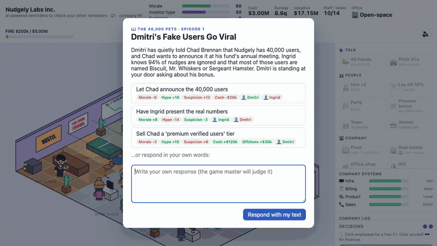

# CEO Tycoon

Satirical isometric tycoon where you're a C-level exec whose real goal is FIRE — via an honest IPO
or by quietly wiring "consulting fees" to Zug. An LLM sits inside the game engine as the game master.



## Run

```bash
cp .env.example .env   # put your ANTHROPIC_API_KEY there
npm install
npm run dev
```

Don't feel like typing? Every free-text box has a **Ghostwriter**: pick a tone (honest, visionary,
corporate, vague, ruthless) and a comms agency writes it for you, for $5k of company money per draft.

Without a key the game still runs with a dumb heuristic "mock GM". Progress autosaves to localStorage.

## Offices

You start in your aunt's garage. You set your own salary — the board and the team compare it to
the company's size every quarter. Garage → coworking → open space (+ east wing) → glass campus, or go remote-first and run the
company as a Zoom grid. Hire beyond your desks and people hot-desk on beanbags (morale tanks).
The office shop sells perks with trade-offs (climbing wall, beer fridge, AI receptionist, valuation
LED wall...), all visible in the office and known to the LLM's office gossip. Perks cost upkeep
every quarter, and the novelty wears off: after a few quarters nobody notices the upside (the
downsides stay).

## Things come back to bite you

- **Company systems** (infra, billing, product, sales) are each understood by exactly one person, who
  is paid accordingly. Fire them to save money and the system rots; below 30 it's a crisis and the
  board calls you in to explain yourself (in writing, judged by the LLM).
- **People remember.** Every employee keeps a history of promises, broken promises, 1:1s and who got
  fired. The LLM reads it in every conversation.
- **Alumni** hold grudges, post Glassdoor reviews, join competitors, and can be rehired as contractors
  at 3x — if your phone call convinces them. Whoever processed your Zug invoices may blow the whistle.
- **Investor KPIs**: numbers you throw around in a pitch get written down and checked later.
- **Term sheets**: you pick the ask and the valuation (fair, optimistic, delusional) and can sweeten
  it with a board seat, a 2x liquidation preference or a personal guarantee. The LLM plays the fund:
  accept, counter or pass. The engine enforces what you signed — the preference eats your IPO, the
  guarantee eats your savings, the board member sticks around.
- **Org chart**: decide who reports to whom and hand out titles (Team Lead → Chief … Officer), then
  announce the reorg and watch the politics. More than 6 direct reports eats one of your decisions
  every quarter; managers' moods leak into their teams; too many layers cost revenue in meetings;
  promote your best engineer to manager and nobody maintains infra anymore. Skip-level 1:1s get noticed.
  Get it right and it pays: few direct reports plus happy managers frees up an extra decision, good
  managers squeeze 10% more out of their teams, and a manager inherits the systems of whoever quits.
- **Hiring**: the LLM sends three candidates with CVs, red flags and whatever they've heard about you.
  Pick one, set salary and a sweetener, make your case. They can say no.
- **Herr Brunner**: money moves to Zug through a scheme of your choice (consulting invoice, Alpine
  "retreat", Cyprus licensing, crypto "treasury"), and he wants a cover story for the auditors.
- **The board** meets every 4 quarters with a motion of its own: appoint a CFO who watches every
  payment, freeze your salary, cut staff, sell the perks, or a vote of no confidence. You argue, they
  vote, the engine enacts it. Every board seat you traded for money is a vote against you.
- **Lifestyle**: a vest, a watch, a Lambo, a penthouse, an ayahuasca retreat. Pay from your own savings
  (FIRE slips away) or put it on the company card (suspicion, someone in finance sees the receipt, and
  auditors who find it make you pay it back). Investors like a CEO who looks successful; the team doesn't.
- **Media**: podcasts, a journalist who asks about whatever she's heard (Zug included), LinkedIn
  posts, paid features. The team reads it too.

## How the LLM is wired in

- `server/llm.ts` — game master: judges free-text actions (all-hands, investor pitch, 1:1s, custom
  event responses), invents quarterly events with choices, writes office gossip.
  Uses structured outputs; every number it returns is clamped.
- `src/game/state.ts` — rule-based simulation (economy, promises, audits, win/lose). The LLM can
  only propose deltas; this owns the numbers.
- `src/scene/OfficeScene.ts` — Phaser isometric office drawn with code (no assets).
- `vite.config.ts` — mounts `/api/*` on the dev server so the key never reaches the browser.

Default game master model is `claude-sonnet-5-5`; override with `CEO_MODEL` in `.env`.

## License

MIT
