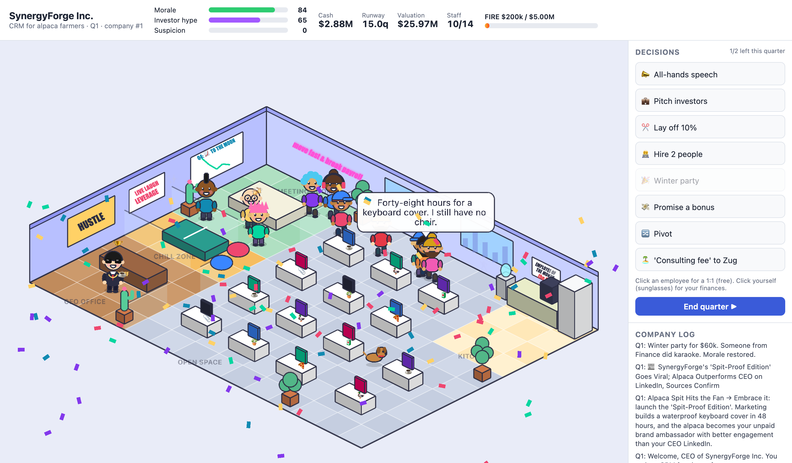

# CEO Tycoon

Satirical isometric tycoon where you're a C-level exec whose real goal is FIRE — via an honest IPO
or by quietly wiring "consulting fees" to Zug. An LLM sits inside the game engine as the game master.



## Run

```bash
cp .env.example .env   # put your ANTHROPIC_API_KEY there
npm install
npm run dev
```

Without a key the game still runs with a dumb heuristic "mock GM".

## How the LLM is wired in

- `server/llm.ts` — game master: judges free-text actions (all-hands, investor pitch, 1:1s, custom
  event responses), invents quarterly events with choices, writes office gossip.
  Uses structured outputs; every number it returns is clamped.
- `src/game/state.ts` — deterministic simulation (economy, promises, audits, win/lose). The LLM can
  only propose deltas; this owns the numbers.
- `src/scene/OfficeScene.ts` — Phaser isometric office drawn with code (no assets).
- `vite.config.ts` — mounts `/api/*` on the dev server so the key never reaches the browser.

Default game master model is `claude-sonnet-5-5`; override with `CEO_MODEL` in `.env`.

## License

MIT
